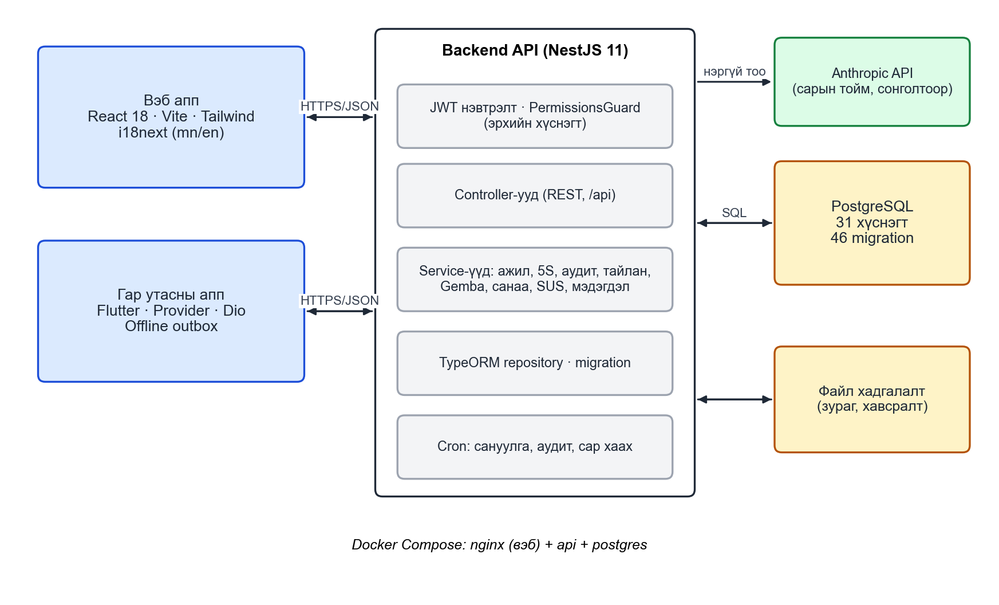
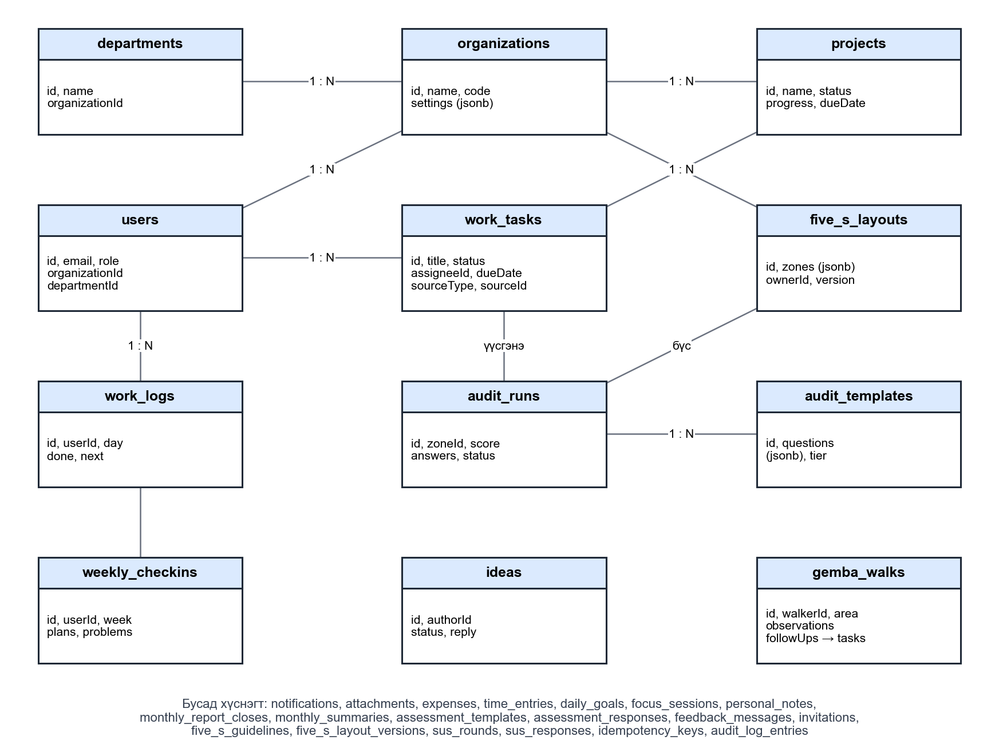

# Architecture

How the system is built, how a request travels through it, and how its main algorithms work. Every file in
`backend/src`, `admin-web/src` and `mobile-flutter/lib` starts with a comment that says what it is for and
what it talks to; this page is the map that connects them. Why things are the way they are is in
[DECISIONS.md](DECISIONS.md); the measures K1–K7 in detail are in [measurements.md](measurements.md).



## 1. Parts

| Part | Folder | Technology | Role |
|---|---|---|---|
| API | `backend/` | NestJS 11, TypeORM, PostgreSQL | All rules and all data. The only part that writes to the database. |
| Web app | `admin-web/` | React 18, Vite, Tailwind, i18next | Managers and administrators: planning, 5S setup, reports, settings. Has a demo workspace that needs no server. |
| Mobile app | `mobile-flutter/` | Flutter, Provider, Dio | Employees on the floor: today's work, audits, red tags, ideas, gemba, check-ins. Works offline. |
| Thesis | `docs/diploma/` | LaTeX, Python (matplotlib, python-pptx) | The diploma text, its figures and the review decks, generated from the code's own results. |
| Deployment | `docker-compose*.yml`, `scripts/` | Docker Compose, nginx, Cloudflare Tunnel | Production on one machine; see [DEPLOY.md](DEPLOY.md). |

The three clients and the API share no code. Where a rule must run on both sides (an audit's score, when a
zone is due), it is written twice and each copy names the other; the server's copy decides.

## 2. Backend

### 2.1 Modules

| Module | Folder | Contents |
|---|---|---|
| `AppModule` | `src/app.module.ts` | Configuration, database, rate limit, the global idempotency and audit-log interceptors. |
| `AuthModule` | `src/auth` | Register, login, refresh, password reset, invitations, JWT strategy. |
| `UsersModule`, `OrganizationsModule` | `src/users`, `src/organizations` | Team members, roles, the organisation's settings. |
| `OperationsModule` | `src/operations` | Everything the product does: projects, tasks, work logs, 5S, audits, ideas, gemba, check-ins, reports, SUS, notifications, attachments. |
| `AuditModule` | `src/audit` | The change history (audit log) and its retention. |
| shared | `src/shared` | Roles and permissions, errors, guards, interceptors, idempotency, mail, metrics, config validation. |

Inside `operations`, files follow one pattern:

- `*.controller.ts` - routes only; every route declares the permission it needs.
- `*.service.ts` - the rules and the database work for one area.
- plain `*.ts` without a suffix (`audit-score.ts`, `monthly-measurements.ts`, `layout-merge.ts`, `sus.ts`...) -
  **pure functions** with no database or Nest dependency. The algorithms live here, and each has a
  `*.spec.ts` next to it.
- `entities/` - one TypeORM entity per table; `dto/` - request bodies with validation.

### 2.2 A request, start to end

```
HTTP ─► ThrottlerGuard (rate limit)
     ─► JwtAuthGuard or OperationsAuthGuard   who is calling (token → user, organisation)
     ─► PermissionsGuard                       may this role do 'area:action'? (shared/roles.ts)
     ─► ValidationPipe                         body and query against the DTO
     ─► IdempotencyInterceptor                 a repeated Idempotency-Key gets the first answer
     ─► AuditLogInterceptor                    successful writes are recorded
     ─► Controller ─► Service ─► OrganizationScope (row must belong to the caller's organisation)
                               ─► TypeORM ─► PostgreSQL
     ◄─ TransformInterceptor ({ data }), LoggingInterceptor, MetricsInterceptor, HttpExceptionFilter (errors as codes)
```

Errors are never free text: services throw `apiError(ErrorCode.X)` (`shared/errors`), and the clients turn
the code into a message in the user's language.

### 2.3 Scheduled jobs

| Job | When | File | Does |
|---|---|---|---|
| `daily-work-reminder` | every hour | `operations/daily-reminder.service.ts` | Sends each organisation its morning reminder when its local time reaches `REMINDER_HOUR` (default 8). |
| `monthly-report-close` | every hour at :15 | `operations/report-archive.service.ts` | Closes the previous month on the organisation's close day. |
| `five-s-audit-due` | daily 06:00 | `operations/audit-scheduler.service.ts` | Raises tasks for 5S audits that have fallen due. |
| `idempotency-key-expiry` | every hour at :40 | `shared/idempotency/idempotency.service.ts` | Deletes keys older than 24 hours. |
| `audit-log-retention` | daily 03:00 | `audit/audit-retention.service.ts` | Deletes audit-log entries past the retention period. |

### 2.4 Database

31 tables, built by 46 migrations (`src/migrations`, files named `*Runtime*` or `*Operations*`; the two
`1700000000000*` files are legacy and are never run). Every operations table has `organizationId`, and every
query is filtered by it. Schema changes are always a new migration; `npm run migration:check` fails when the
entities and migrations disagree.



## 3. Web app

```
main.tsx ─► App.tsx (routes, lazy pages) ─► pages/*Page.tsx ─► components/<area>/*
                                         └► services/*.service.ts ─► services/api.ts ─► API
contexts/: AuthContext (who is signed in), ThemeContext, NotificationContext (toasts)
i18n/: mn (default) and en; every visible string is a key, never text in a component
```

- **One page per route** (`App.tsx` lists them). Each page file's header names its path.
- **Services** are the only code that calls the API. `api.ts` holds the access token **in memory only**; a
  reload gets a new one through the HttpOnly refresh cookie, and concurrent 401s share one refresh.
- **Pure modules** (`components/*/*.ts` without JSX: `taskCompletion`, `weeklyMeasurements`, `auditAnswers`,
  `holdingRules`...) do the calculations; components only draw.
- **Demo workspace**: a flag in `sessionStorage` (`demoSession`) makes services answer from local demo data
  (`demoPlanStore`, `demoGuidelineContent`), so the app can be shown without a server.

## 4. Mobile app

```
main.dart ─► app_router.dart ─► screens/*_screen.dart ─► providers/*_provider.dart ─► services/api_service.dart ─► API
                                                                  ├► services/outbox.dart      writes waiting for a network
                                                                  └► services/read_cache.dart  last reads, for offline viewing
```

- **Outbox**: a write that gets no answer (no network, timeout, lost reply) is kept with its
  `Idempotency-Key` and sent again when the network returns. The key is made *before* the first send, so a
  write that reached the server but lost its answer is not saved twice (found by the network-drop test).
- **Read cache**: each screen keeps what it last read and shows it, with its time, when there is no network.
  It is one person's view and is emptied when the signed-in person changes; the outbox is not.
- All text is in `utils/phase_one_strings.dart` (mn and en).

## 5. Algorithms

| Algorithm | Where | In one sentence |
|---|---|---|
| Permissions | `shared/roles.ts` | One table maps each role to its permissions; a role may only grant roles strictly below its own. |
| Audit score | `operations/audit-score.ts` (+ web `auditAnswers.ts`, phone `five_s_model.dart`) | Score questions earn their value, yes/no earn 1 for yes, text earns nothing; the server recomputes the client's number. |
| Audit schedule and tiers | `operations/audit-schedule.ts`, `audit-tiers.ts` | A zone is due at its last audit plus its frequency, on the organisation's calendar; tiers (operator daily, supervisor weekly, manager monthly) apply to every zone. |
| Fix verification (PDCA Check) | `operations/improvement-verification.ts` | A closed fix is verified by the next audit of the same zone: verified ≥ 85, improved, not improved, or awaiting re-audit. |
| Task completion month | `operations/task-completion.ts` | A task belongs to the month it was *finished* in, on the organisation's clock, not to its current status. |
| K1–K6 | `operations/monthly-measurements.ts`, `weekly-measurements.ts` | Each measure is value / numerator / denominator / excluded; weeks reuse the month function over Monday–Sunday ranges. |
| Month close | `operations/report-archive.service.ts`, `organization-clock.ts` | On the close day the previous month's report is frozen; later edits cannot change a reported month. |
| Floor-plan merge | `operations/layout-merge.ts` | Saving the plan keeps what the floor wrote meanwhile: later dates win, closed tags stay closed, unseen new tags are kept. |
| Idempotency | `shared/idempotency/` | (user, key) is unique; the first answer is stored and replayed; a key reused for another request is refused. |
| SUS (K7) | `operations/sus.ts` | Odd items score answer − 1, even items 5 − answer, sum × 2.5; totals only, and only from three respondents. |

## 6. Tests

| Level | Command | Where |
|---|---|---|
| Backend unit and HTTP | `cd backend && npm test` | `src/**/*.spec.ts` |
| Use-case acceptance (real PostgreSQL) | `cd backend && npm run test:uc` | `test/use-cases/` |
| Web | `cd admin-web && npm test` | `src/**/*.test.ts(x)` |
| Browser | `cd admin-web && npx playwright test` | `e2e/` |
| Mobile | `cd mobile-flutter && flutter test` | `test/` |
| All, into docs/RESULTS.md | `cd backend && npm run results` | `backend/scripts/results.ts` |
